# KITOS 2.0 — Project Report (Chapters 1–5)

> Markdown copy of `KITOS-2.0-Project-Report.docx`. Figures are in `docs/figures/`.

# CHAPTER ONE: INTRODUCTION

## 1.1 Background of the Study

Digital skills have moved from being an advantage to being a baseline expectation for participation in the modern economy. In Nigeria, the National Information Technology Development Agency (NITDA) has set a national target of 95% digital literacy by 2030, with an interim milestone of 70% by 2027, under its Strategic Roadmap and Action Plan 2024–2027 (Voice of Nigeria, 2024). At the same time, internet access is expanding but remains uneven: Nigeria's internet penetration crossed 50% for the first time in November 2025 (50.58%, about 109 million broadband subscriptions), still well short of the 70% target set in the National Broadband Plan 2020–2025 (TechCabal, 2025). The gap between ambition and access is widest for children outside major cities, who often meet technology first as consumers rather than as creators.

Kids In Tech (KIT) is a STEM programme operated by StarNova Labs, a Nigerian technology studio, that teaches coding, design and robotics to children aged 8 to 18. KIT runs physical bootcamps in Birnin Kebbi and Sokoto, and has completed three bootcamp cohorts with more than 111 students trained (Kids In Tech, 2026). Its curriculum follows a branching learning path: every learner starts with Scratch Programming (computational thinking through block-based games and stories), then continues into Web Development or Robotics in parallel, before an Advanced Track.

The physical bootcamps work well as a spark, but a bootcamp is by nature short. The organisation's own founding story names the problem directly: the goal is to "break the cycle of one-off events with a sustainable, evolving learning path" (Kids In Tech, 2026). To sustain learning between and after cohorts, StarNova Labs began building KITOS (Kids In Tech Operating System), a learning management system (LMS) that supports online sessions alongside the physical classes. This project takes that system as its case study: it keeps the KITOS interface that has already been built and gives it a real, cloud-native backend on the MERN stack (MongoDB Atlas, Express, React and Node.js), turning a front-end prototype into a production system.

## 1.2 The Existing System

An audit of the current KITOS codebase (repository `kit-lms-main`) and its predecessor (`LMS/kit-lms`) shows a system that is visually rich but not yet production-ready:

- **The frontend is complete but runs on mock data.** It is a Next.js 16 / React 19 application with dashboards for four roles (student, parent, instructor and administrator). Every API call is intercepted by Mock Service Worker (MSW) and answered from in-memory fixtures. The handoff document states plainly that "all data is mocked via MSW" and that the chat WebSocket "is wired but no Socket.io server is running".
- **The backend is fragmented and unsafe to deploy.** A PHP/MySQL API exists alongside an earlier FastAPI/MongoDB prototype generated with an AI builder. Neither is connected to the current frontend, and field names in the three codebases disagree (quizzes belong to modules in the SQL schema but to lessons in the frontend type definitions). The PHP API is a single 3,579-line `index.php` that routes about 115 endpoints through a chain of `if` statements over 15 MySQL tables. Its review (Section 3.3.1) found critical defects: JWT signature verification is switched off ("disabled for development"), so any forged token is accepted; the signing secret and database credentials are hard-coded in `config.php`; the refresh token is a random placeholder; a "must reset password" state is detected by testing whether the password equals a known default; database error details are returned to the client; and there is no enrolment table, so enrolment is inferred from a free-text `programme_track` field and from payments.
- **The interface is a strong asset, but its identity is incomplete.** The design is clean and consistent (Plus Jakarta Sans and Space Mono type, an emerald `#10B981` accent on navy `#0B1220`, light and dark themes), but the product is represented by a generic lightning-bolt icon rather than the Kids In Tech logo, and it carries no attribution to StarNova Labs, the organisation that builds and operates it.
- **Hybrid delivery is only partly modelled.** Live online classes, recordings and attendance exist in the interface, but physical bootcamp attendance, cohorts, and the branching curriculum are not first-class concepts in any of the data models.
- **There is no deployment pipeline.** Nothing is deployed with a working backend, and there are no automated tests, continuous integration or environment configuration for production.

## 1.3 Statement of the Problem

Kids In Tech delivers its teaching in two places, a physical classroom and an online space, but only one of them is supported by software, and that software does not yet work end to end. As a result:

1. Learning stops when a bootcamp ends. There is no reliable platform on which students can continue lessons, submit work and receive feedback between cohorts.
2. Online sessions are organised through scattered tools (WhatsApp groups, Google Forms, meeting links shared by hand), so attendance, recordings and progress are not captured in one place.
3. Parents, who pay for and consent to their children's participation, have no single view of progress, attendance, payments or communication with instructors.
4. Children's personal data is handled informally. The Nigeria Data Protection Act 2023 requires a data controller to obtain the consent of a parent or guardian before processing a child's data and to use appropriate means to verify age and consent (NDPA, 2023, s. 31; Udo Udoma & Belo-Osagie, 2024). The current tools do not enforce this.
5. The existing LMS cannot scale or be maintained: its backend is split across three incompatible implementations, it cannot be deployed, and its interface does not represent the KIT brand.

The problem this study addresses is therefore the absence of a secure, scalable, child-appropriate cloud platform that unifies physical and online learning for Kids In Tech.

## 1.4 Aim and Objectives

The aim of this study is to design, develop and deploy KITOS 2.0, a cloud-based hybrid learning management system for Kids In Tech, using the MERN stack and a research-informed, child-centred design.

The specific objectives are to:

1. Review the literature on blended learning, children's computing education, LMS adoption in Nigeria and cloud-native architecture, in order to justify the problem and derive design requirements.
2. Retain the existing KITOS Next.js interface, connect it to a real backend in place of mock data, and complete its brand identity with the Kids In Tech logo and a "Powered by StarNova Labs" attribution, while meeting accessibility (WCAG 2.2 AA) and performance targets.
3. Design and implement a modular RESTful backend with Node.js, Express and MongoDB Atlas that supports four roles, a branching curriculum, hybrid (physical and online) sessions, assessment, certificates, payments and real-time communication.
4. Build security and child-safety controls into the architecture: role-based access control, parental consent, restricted messaging, audit logging and protection against the OWASP Top 10 risks.
5. Deploy the system to public cloud platforms (Vercel, Render and MongoDB Atlas) with continuous integration and automated testing, so that it is reachable through a public link.
6. Evaluate the system against its functional and non-functional requirements and document the results.

## 1.5 Research Questions

1. What features and qualities should a learning platform have in order to sustain learning between physical coding bootcamps for children aged 8 to 18 in Northern Nigeria?
2. How can a MERN architecture deployed on managed cloud services meet the scalability, security and cost constraints of a small Nigerian EdTech organisation?
3. How can child-safety and data-protection obligations be enforced in the design of the system rather than left to policy?
4. To what extent does the completed system meet its usability, performance and accessibility targets?

## 1.6 Significance of the Study

- **For Kids In Tech and StarNova Labs**, the study produces a working platform that turns one-off bootcamps into a continuous programme, gives administrators a single source of truth for students, cohorts, attendance and payments, and provides a foundation for planned features such as partner-school portals and an AI tutor.
- **For parents**, it provides transparency and control: consent, progress, attendance, payments and moderated communication in one place, in English or Hausa.
- **For learners**, it provides a safe, encouraging, mobile-friendly space to keep building after the classroom session ends.
- **For practitioners and researchers**, it documents how a small African EdTech organisation can build a production-grade, child-safe LMS on free and low-cost cloud tiers, and how data-protection law can be translated into concrete architectural controls.

## 1.7 Scope of the Study

The study covers the analysis, design, implementation, testing and cloud deployment of KITOS 2.0. The existing frontend design is retained; the work focuses on the backend, data, integration and deployment. In scope are: authentication and role management for administrators, instructors, parents and students; parent–child linking with consent; courses, modules, lessons, quizzes and assignments; learning tracks and cohorts; physical and online sessions with attendance and recordings; progress tracking and verifiable certificates; Paystack payments in test mode; real-time chat with child-safety restrictions; notifications and announcements; analytics and audit logs; English and Hausa interface languages; and deployment with CI.

Out of scope are: a full visual redesign of the interface, a native mobile application, an AI tutor, live video streaming built into the platform (sessions link to Google Meet or Zoom), partner-school teacher portals, and production payment settlement. These are recorded as future work.

## 1.8 Limitations of the Study

The system is deployed on free cloud tiers, so the API host sleeps when idle and takes 30 to 50 seconds to wake. Evaluation is limited to the development team, KIT instructors and a small group of pilot users rather than a large controlled trial. Hausa translations cover the interface chrome and need review by a native speaker before wide release. Payment integration runs in Paystack's test mode.

## 1.9 Definition of Terms

| Term | Meaning in this study |
|---|---|
| Blended (hybrid) learning | Instruction that combines face-to-face sessions with online learning activities. |
| LMS | Learning Management System: software for delivering, tracking and managing learning. |
| KITOS | Kids In Tech Operating System, the LMS that is the subject of this study. |
| MERN | A JavaScript stack of MongoDB, Express, React and Node.js. |
| Cohort | A group of students who take a bootcamp or track together over the same dates. |
| Track | One branch of the KIT learning path: Scratch, Web Development, Robotics or Advanced. |
| Admission number | A unique student identifier in the format `KIT/26/001`, used by children to sign in. |
| RBAC | Role-Based Access Control: permissions granted according to a user's role. |
| CI/CD | Continuous Integration and Continuous Delivery: automated build, test and deploy. |
| NDPA | Nigeria Data Protection Act 2023. |

## 1.10 Organisation of the Report

Chapter One introduces the study. Chapter Two reviews related literature and existing systems and presents the conceptual framework. Chapter Three describes the methodology, requirements and system design, including the architecture, data model and security design. Chapter Four covers implementation, testing and cloud deployment. Chapter Five summarises the work, states its contributions and limitations, and makes recommendations.

# CHAPTER TWO: LITERATURE REVIEW

## 2.1 Introduction

This chapter reviews the literature that justifies the problem and shapes the design of KITOS 2.0. It covers five areas: blended learning and its effectiveness; computing education for children; e-learning adoption in Nigeria; learning management systems and their design; and the cloud-native architecture, security and child-protection practices that a production web system must follow. It ends with a review of existing platforms, the gap this study fills, and a conceptual framework.

## 2.2 Blended Learning

Blended learning combines face-to-face instruction with computer-mediated activities (Graham, 2006). Garrison and Kanuka (2004) describe it as a "thoughtful integration" of classroom and online experiences rather than an addition of one to the other, and argue that its value lies in extending the community of inquiry beyond the limits of time and place. This framing matches the KIT situation exactly: the bootcamp provides the community and the spark, and the online space extends it.

The evidence for blended learning is encouraging. In a meta-analysis for the US Department of Education, Means et al. (2010; 2013) found that students in online conditions performed modestly better on average than those in face-to-face instruction, and that the advantage was larger for blended conditions. The authors caution that blended conditions often included extra learning time and materials, so the benefit should not be attributed to the medium alone, and that rigorous K-12 studies were few. Two design lessons follow. First, the online component must add genuine learning time and activity (practice, feedback, revision) rather than duplicate the classroom. Second, the evidence is thinner for children, so a children's platform should be evaluated in its own context.

The COVID-19 period accelerated online learning worldwide and exposed its weaknesses. Dhawan (2020) identifies poor connectivity, low digital literacy among teachers and families, and loss of engagement as the main barriers, and recommends flexible, low-bandwidth designs and stronger feedback loops. UNESCO's Global Education Monitoring Report (2023) adds that education technology only helps when it is appropriate to its context, and warns against platforms that exclude learners without devices or data, or that collect children's data without adequate protection.

## 2.3 Computing Education for Children

Modern children's computing education draws on constructionism, the idea that children learn best when they build things that are meaningful to them (Papert, 1980). Scratch, the block-based environment from the MIT Media Lab, applies this idea at scale: children create interactive stories and games by snapping blocks together, which removes syntax errors and lets them focus on logic, sequencing and creativity (Resnick et al., 2009). Wing (2006) argues that computational thinking (decomposition, abstraction, pattern recognition and algorithm design) is a fundamental skill for everyone, not just future programmers. Bers (2018) extends this to early childhood and frames coding as a "playground" in which children develop problem solving, persistence and social skills as well as technical ones.

Three implications for a children's LMS follow. Learning should be project-based, so the platform must support submissions of real artefacts (Scratch project links, code repositories, photos of robots) rather than only quizzes. Feedback should be encouraging, since confidence is an explicit learning outcome; KIT already has a policy of mandatory positive language toward every child, which the platform should support with feedback templates and moderation. And learners progress at different speeds along different branches, so the system should model tracks and prerequisites rather than a single linear course list. Kafai and Burke (2014) also stress the social dimension of children's coding (sharing, remixing and showing work), which supports features such as project showcases and parent visibility.

## 2.4 Designing Interfaces for Children

Children are not small adults. Hourcade (2008) summarises research showing that children have less developed fine motor control, shorter attention spans and different mental models of interfaces, and benefits from larger targets, clear feedback and minimal text. The Nielsen Norman Group's usability studies with children aged 3 to 12 report that children rely on visual cues, dislike ambiguous navigation, and are put off by text-heavy screens and advertising (Sherwin & Nielsen, 2019). For teenagers, the same research finds that interfaces which look "babyish" are rejected. Since KIT serves ages 8 to 18, the design must be friendly without being childish: bold colour and clear iconography, but with mature typography and layouts.

Accessibility is both a legal and an ethical requirement. The Web Content Accessibility Guidelines 2.2 (W3C, 2023) set testable success criteria for perceivable, operable, understandable and robust content, including a minimum contrast ratio of 4.5:1 for body text, keyboard operability, and a target size of at least 24 by 24 CSS pixels. These criteria are adopted as non-functional requirements in Chapter Three.

## 2.5 E-Learning and LMS Adoption in Nigeria

Studies of e-learning in Nigeria report consistent barriers: unreliable power and connectivity, the cost of mobile data, limited devices, and inadequate training (Eze, Chinedu-Eze & Bello, 2018). Eze et al. found that where e-learning facilities were available, utilisation was low, largely because of infrastructure and skills gaps rather than lack of interest. Mobile phones are the dominant access device for most Nigerian households, so mobile-first, data-light design is essential.

Technology adoption models help explain what makes users accept a new system. The Technology Acceptance Model (Davis, 1989) holds that perceived usefulness and perceived ease of use are the main determinants of intention to use a system. DeLone and McLean's (2003) updated Information Systems Success Model adds system quality, information quality and service quality as drivers of use, user satisfaction and net benefits. For KITOS, perceived usefulness for parents means visibility of progress and attendance; for instructors, it means less administrative work; for children, ease of use and enjoyment matter most. System quality, in a low-bandwidth environment, depends heavily on performance.

## 2.6 Learning Management Systems

An LMS provides the infrastructure for delivering content, managing enrolments, assessing learners and reporting progress. Open-source platforms such as Moodle, designed on social-constructionist principles (Dougiamas & Taylor, 2003), and commercial platforms such as Google Classroom and Canvas dominate the market. Their strengths are maturity and breadth. Their weaknesses for KIT are fit and weight: they are designed for schools and universities rather than for a bootcamp-plus-online model; they do not model cohorts, physical attendance and a branching track structure out of the box; their interfaces are generic; and self-hosting Moodle requires PHP server administration that a small team cannot sustain. Child-focused platforms such as Code.org and Scratch provide excellent content but are not management systems for a specific programme: they do not handle parents' payments, local cohorts or Hausa-language interfaces.

## 2.7 Cloud Computing and Cloud-Native Architecture

The National Institute of Standards and Technology defines cloud computing by five essential characteristics: on-demand self-service, broad network access, resource pooling, rapid elasticity and measured service (Mell & Grance, 2011). For a small organisation, the Platform-as-a-Service (PaaS) model is the most relevant, because it removes server administration while keeping control over application code. Managed services such as Vercel (frontend hosting with a global edge network), Render (container-based web services) and MongoDB Atlas (managed database clusters) offer free tiers that make production deployment affordable.

Cloud-native applications are built to exploit these platforms. The Twelve-Factor App methodology (Wiggins, 2011) codifies practices such as storing configuration in the environment, treating backing services as attached resources, keeping processes stateless, and maintaining parity between development and production. These practices directly shape the KITOS design: secrets live in host dashboards rather than in code, file uploads go to an object store (Cloudinary) rather than the ephemeral server disk, and the API is stateless apart from its database.

## 2.8 The MERN Stack, REST and Document Databases

The MERN stack uses JavaScript (or TypeScript) across the whole application: MongoDB for storage, Express for the HTTP layer, React for the user interface and Node.js as the runtime. A single language lowers context switching, allows the same validation library (Zod) and conventions on client and server, and suits a small team.

REST (Representational State Transfer), introduced by Fielding (2000), structures an API around resources, uniform interfaces and stateless requests, which makes it cacheable, scalable and easy to document. MongoDB is a document database, one of the NoSQL families surveyed by Cattell (2011), which trade some relational features for flexible schemas and horizontal scaling. Its document model fits LMS content well: a course with nested modules and lessons, or a quiz with embedded questions, maps naturally to documents, while references are used where data is shared or grows without bound (enrolments, submissions, messages). Since version 4.0, MongoDB supports multi-document ACID transactions on replica sets, which Atlas clusters are by default; this matters for operations such as confirming a payment and activating an enrolment together.

## 2.9 Security and Child Data Protection

The OWASP Top 10 (OWASP Foundation, 2021) lists the most critical web application security risks, led by broken access control, cryptographic failures and injection. A multi-role LMS is particularly exposed to broken access control, since every resource (a child's submission, a parent's payment, a private message) belongs to a specific person. Mitigation requires server-side authorisation on every request, not just hidden buttons in the interface. JSON Web Tokens (Jones, Bradley & Sakimura, 2015) are widely used for stateless authentication; best practice keeps access tokens short-lived and stores refresh tokens in secure, HTTP-only cookies so that scripts cannot read them.

Children's data needs extra protection. Livingstone, Stoilova and Nandagiri (2019) show that children have limited understanding of how their data is collected and used, and argue that responsibility must rest with service designers and parents rather than with the child. In Nigeria, the NDPA 2023 defines a child as anyone under 18 and requires the consent of a parent or legal guardian before a child's data is processed, along with appropriate age and consent verification (NDPA, 2023; Udo Udoma & Belo-Osagie, 2024). The earlier NDPR Implementation Framework also requires child-friendly privacy notices for services aimed at children. These obligations translate into concrete requirements: parent-created child accounts, recorded consent, data minimisation (no public profiles, no child email required), restricted messaging and an audit trail.

## 2.10 Review of Existing Systems

| System | Strengths | Limitations for KIT |
|---|---|---|
| Moodle | Mature, free, highly configurable, large plugin ecosystem | Heavy PHP hosting and administration; generic interface; no native cohort-plus-physical-attendance model; dated mobile experience |
| Google Classroom | Free, simple, familiar to teachers | Requires Google Workspace accounts for children; no payments; limited parent view; no branding; data held by a third party |
| Canvas LMS | Modern interface, strong assessment tools | Designed for institutions; costly hosted plans; complex for a small programme |
| Code.org / Scratch | Excellent child-centred coding content | Content platforms, not management systems: no payments, cohorts, attendance or programme branding |
| uLesson / local EdTech apps | Local curriculum, offline-friendly video | Focus on school subjects, not coding bootcamps; closed platforms |
| KITOS (current) | Complete four-role interface, Hausa support, sessions and recordings screens | Runs on mock data; three incompatible backends; off-brand design; not deployed; no tests |

## 2.11 Research Gap

The literature supports blended learning as an effective model, especially when the online component adds practice and feedback, and supports constructionist, project-based approaches to children's computing. It also identifies connectivity, cost and usability as the main barriers to e-learning in Nigeria, and data protection as a growing obligation. Existing platforms are either general-purpose institutional systems or content sites; none combines a bootcamp-plus-online model, cohort and physical attendance management, a branching coding curriculum, parent consent and payments, child-safe communication, and a bilingual English–Hausa interface in a package that a small Nigerian organisation can run on free cloud tiers. KITOS 2.0 is designed to fill that gap.

## 2.12 Conceptual Framework

The framework in Figure 2.1 links the theoretical foundations to the design of the system. Blended learning theory and constructionism define what the platform must do pedagogically (extend the classroom, support projects and feedback). The Technology Acceptance and IS Success models define what makes it adoptable (usefulness, ease of use, system quality). Cloud-native and security principles, together with the NDPA, define how it must be built. These inputs produce the requirements in Chapter Three and are tested by the evaluation in Chapter Four.

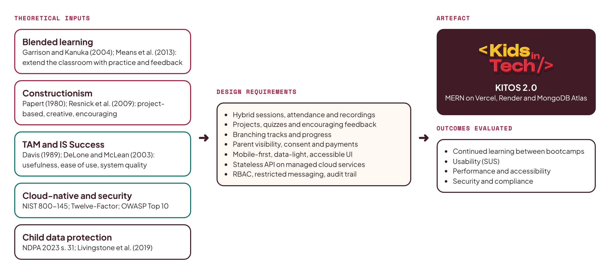

## 2.13 Summary

The reviewed literature justifies a hybrid learning platform for KIT and sets out the qualities it needs: project-based learning and encouraging feedback, child-appropriate and accessible interfaces, mobile-first and data-light delivery, strong access control and child data protection, and an architecture that a small team can deploy and maintain on managed cloud services.

# CHAPTER THREE: METHODOLOGY AND SYSTEM DESIGN

## 3.1 Introduction

This chapter describes how the system was developed and designed. It presents the research methodology, the requirements gathered from stakeholders and the existing system, the system architecture and technology choices, the data model, the security and child-safety design, and the user interface design.

## 3.2 Research Methodology: Design Science Research

The study follows the Design Science Research Methodology (DSRM), which creates and evaluates an artefact intended to solve an identified problem (Hevner et al., 2004; Peffers et al., 2007). DSRM fits a project whose main output is a working system and whose contribution lies in both the artefact and the knowledge gained from building it. Its six activities were applied as shown in Figure 3.1.

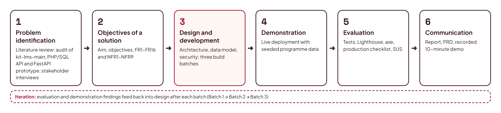

1. **Problem identification and motivation**: literature review (Chapter Two), audit of the three existing KITOS codebases, and discussions with KIT instructors and the operations team.
2. **Objectives of a solution**: the aim and objectives in Section 1.4, refined into functional and non-functional requirements (Section 3.4).
3. **Design and development**: architecture, data model and interface design (this chapter), and implementation in three iterative batches (Chapter Four).
4. **Demonstration**: deployment to public cloud infrastructure and demonstration with seeded, realistic programme data.
5. **Evaluation**: automated tests, performance and accessibility audits, a production test checklist and usability feedback (Section 4.7).
6. **Communication**: this report, the product requirements document, and a recorded ten-minute demonstration.

Within the design-and-development activity, an **iterative, incremental** software process was used. Work was divided into three batches, each producing a deployable, tested increment, in the manner of agile delivery. This allowed early feedback and limited the risk of a single large integration at the end.

## 3.3 Requirements Gathering

Requirements came from four sources:

- **Codebase analysis.** The current KITOS frontend (about 60 screens across four roles), its JSDoc schema definitions, its 2,100-line mock handler file, the PHP/MySQL schema and the FastAPI prototype were analysed to extract every entity, endpoint and user journey that already existed. This preserved the product knowledge built into the earlier work, and the frontend's service files became the API contract for the new backend.
- **Stakeholder input.** Informal interviews with the KIT founder, operations lead and instructors identified pain points: scattered WhatsApp and Google Form workflows, no attendance record for online sessions, parents asking for progress updates by phone, and the need for Hausa support.
- **Programme documents.** The KIT website data files (programmes, bootcamps, KITOS feature list) defined the learning path, age range, certificates and planned features.
- **Literature.** Chapter Two contributed requirements for accessibility, child safety, low-bandwidth performance and security.

## 3.4 Requirements Specification

### 3.3.1 Analysis of the Legacy PHP/MySQL Backend

The legacy backend was studied in full because it records the business rules the team had already agreed. Its schema (`api/schema.sql`) defines 15 InnoDB tables, shown in Figure 3.2. Users hold credentials, role and language; `parents` and `students` extend users one-to-one; a student belongs to one parent and carries a free-text `programme_track`; courses contain modules, modules contain lessons, quizzes and assignments; quizzes contain questions with options stored as a JSON string; submissions, quiz submissions and lesson completions link students to work; payments link parents and students and carry a unique Paystack reference; messages and notifications belong to users. Platform settings are kept in a JSON file on disk rather than in the database.

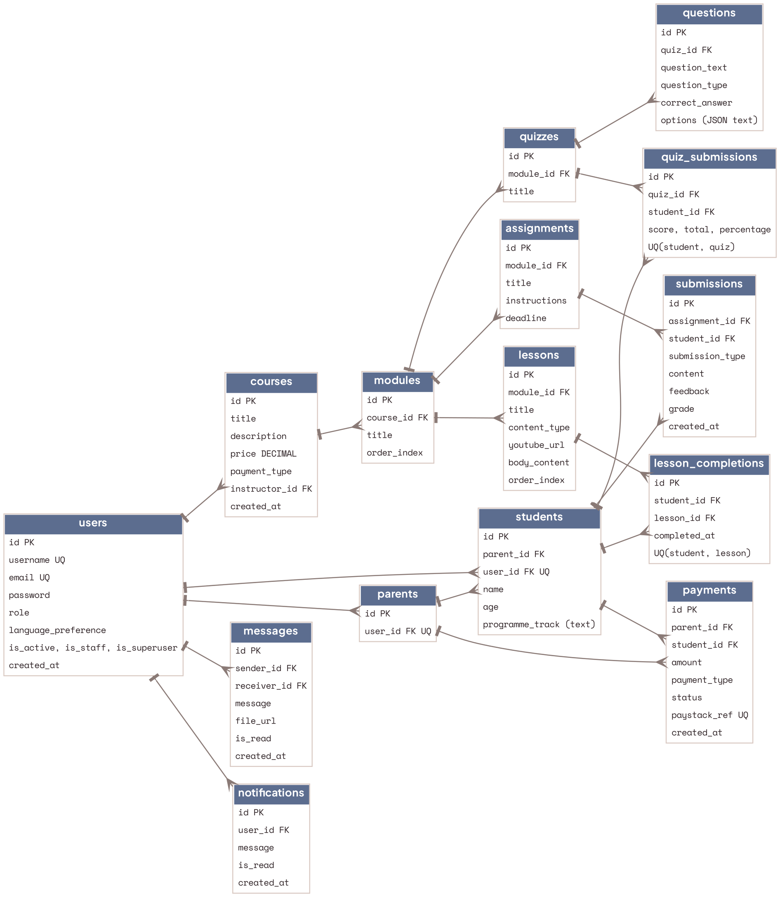

`index.php` handles authentication (login, forgot and reset password, change password, profile and language), user, student and parent management, instructor views, course, module, lesson, quiz and assignment CRUD with publish and unpublish, lesson completion, quiz submission and results, submissions and feedback, payments with receipts, a simulated Paystack initiate and verify, messages and conversations, notifications and announcements, certificates, subscriptions, and an admin area (stats, users, courses, analytics, payments, pending enrolments, activity log, permissions, admission numbers, activation and instructor assignment). This inventory was mapped endpoint by endpoint to the frontend's Axios services to produce the contract for the new API. Table 3.1 shows how each relational table maps to a MongoDB collection.

| Legacy MySQL table | KITOS 2.0 collection | Change |
|---|---|---|
| users | users | `username` split into `name` and `admission_no`; adds `must_reset_password` flag, `token_version`, `is_active` |
| parents, students | users + students | One-to-one tables folded into a role on `users` and a `students` profile document |
| courses, modules, lessons | courses, modules, lessons | Same hierarchy; ids become ObjectIds; lessons gain `resources[]` |
| quizzes, questions | quizzes (questions embedded) | Questions always read with their quiz, so embedded; options become a real array |
| assignments, submissions | assignments, submissions | Unchanged in meaning; file uploads move to Cloudinary |
| lesson_completions, quiz_submissions | lesson_completions, quiz_attempts | Unique compound indexes preserved |
| (none) | enrollments | New: explicit enrolment with status and progress replaces inference from `programme_track` |
| payments | payments, subscriptions | Adds `receipt_no`, `course_id` and verified status history |
| messages | conversations, messages | Conversations make child-safety rules enforceable |
| notifications | notifications, announcements | Adds `type`, `title`, `link` used by the frontend |
| settings.json file | settings | Moved into the database, since cloud disks are ephemeral |
| (none) | sessions, attendance, recordings, certificates, consents, cohorts, activity_logs, counters | New: hybrid delivery, verification, NDPA consent and audit |

**Table 3.1: Mapping from the legacy relational schema to MongoDB collections**

### 3.4.1 Stakeholders and Roles

| Role | Description | Key goals |
|---|---|---|
| Super Admin / Admin | KIT operations staff | Manage users, cohorts, courses and payments; monitor safety; view analytics |
| Instructor | KIT tutors | Build content, run sessions, take attendance, review work, communicate with students |
| Parent / Guardian | Pays for and consents to a child's participation | Register children, give consent, track progress and attendance, pay fees, contact staff |
| Student (8–18) | The learner | Attend sessions, complete lessons and projects, take quizzes, earn certificates |

### 3.4.2 Functional Requirements

| ID | Requirement |
|---|---|
| FR1 | Users sign in with email and password; students sign in with an admission number and password. Password reset by email; forced reset on first sign-in for admin-created accounts. |
| FR2 | Parents register, add children, and record consent before a child account is activated. Admins can also create parent and student accounts. |
| FR3 | The system generates unique admission numbers in the format `KIT/YY/NNN`. |
| FR4 | Admins manage tracks, cohorts, courses, modules and lessons; instructors manage content for courses assigned to them. Lessons support text, video (YouTube), downloadable resources and external project links. |
| FR5 | Instructors create quizzes (auto-graded) and assignments (project submissions with link or file); they review submissions with grades and feedback drawn from encouraging templates. |
| FR6 | Students enrol in courses through a cohort; progress is tracked per lesson and recalculated when content changes. Prerequisites gate the branching tracks. |
| FR7 | Instructors schedule sessions as physical, online or hybrid, with venue or meeting link; students and parents see upcoming and live sessions. |
| FR8 | Attendance is recorded for every session: by instructor roster, QR code check-in for physical classes, or automatic join tracking for online classes. |
| FR9 | Recordings of online sessions are attached to sessions and available to enrolled students. |
| FR10 | Certificates are issued automatically on course completion as branded PDFs with a public verification page and code. |
| FR11 | Parents pay fees through Paystack; payments are verified server-side by webhook, receipts are generated, and enrolment activates on success. |
| FR12 | Real-time chat between student and instructor, parent and instructor, and parent and admin; no student-to-student private messaging; parents can view their child's conversations; admins can monitor. |
| FR13 | In-app notifications and email for key events; admins broadcast announcements to roles, cohorts or courses. |
| FR14 | Admin dashboard with KPIs and analytics (enrolments, attendance, completion, revenue); CSV export. |
| FR15 | Every administrative change and security event is written to an append-only audit log. |
| FR16 | Interface available in English and Hausa, with light and dark themes and a data-saver mode. |

### 3.4.3 Non-Functional Requirements

| ID | Category | Requirement |
|---|---|---|
| NFR1 | Performance | Lighthouse performance score of 90 or more on key pages; API p95 response under 500 ms after warm-up; JavaScript under 200 KB gzipped on the student lesson page. |
| NFR2 | Accessibility | WCAG 2.2 AA; Lighthouse accessibility of 95 or more; no serious or critical axe violations. |
| NFR3 | Security | OWASP Top 10 mitigations; server-side RBAC on every endpoint; passwords hashed with bcrypt (cost 12); rate limiting on authentication; secrets only in environment variables. |
| NFR4 | Privacy | NDPA-aligned parental consent; data minimisation; child-friendly privacy notice; no third-party trackers in the student area. |
| NFR5 | Scalability | Stateless API, horizontally scalable; database indexes on all query paths; pagination on all lists. |
| NFR6 | Availability | Health-check endpoint; automatic redeploy on push; rollback in one action. |
| NFR7 | Usability | Responsive from 360 px to 1920 px; touch targets of at least 44 px; maximum of three clicks to any core student task. |
| NFR8 | Maintainability | Layered architecture; Zod-validated inputs and JSDoc-typed models; at least 70% test coverage on services; documented API. |
| NFR9 | Portability | Twelve-factor configuration; runs locally with an in-memory MongoDB and no external accounts. |

## 3.5 Use Case Model

Figure 3.3 summarises the main use cases for each actor. Shared use cases (sign in, notifications, settings, language) are available to all roles.

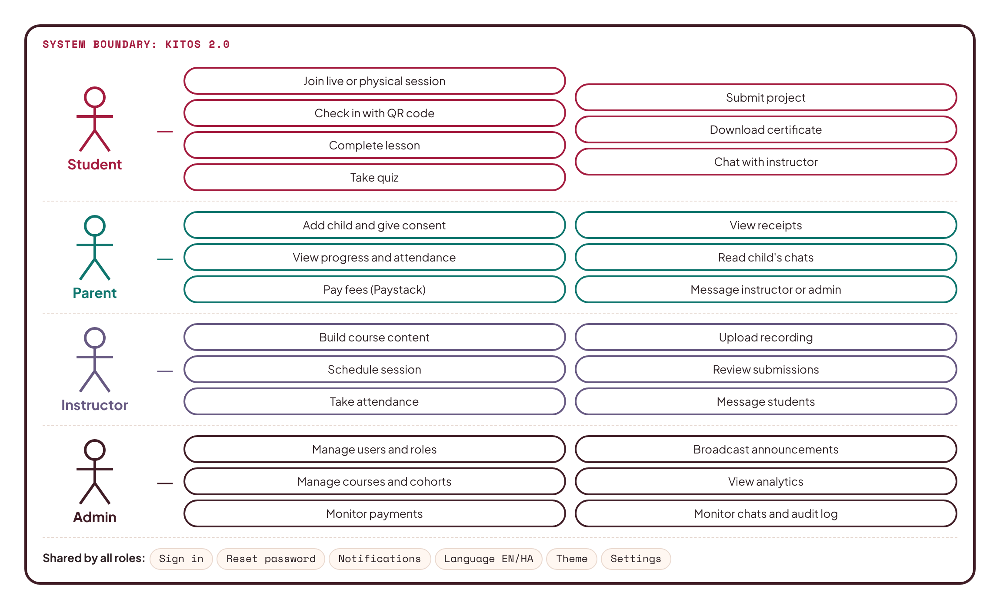

## 3.6 System Architecture

KITOS 2.0 uses a three-tier, layered client–server architecture deployed across managed cloud services (Figure 3.4).

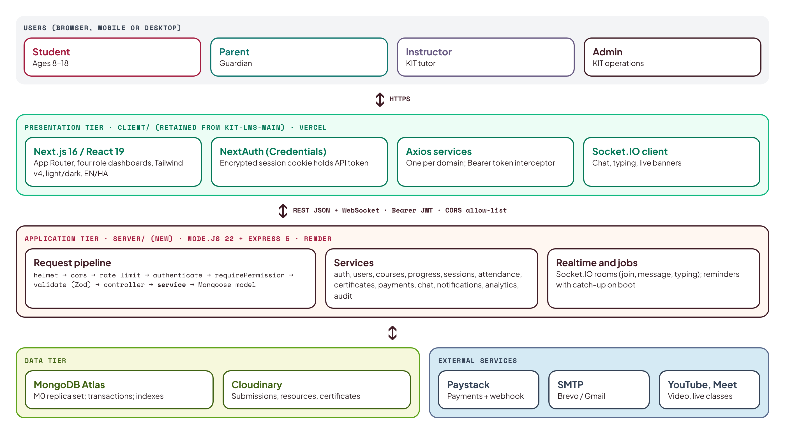

**Presentation tier.** The existing KITOS frontend (`kit-lms-main`) is retained: a Next.js 16 application with React 19, written in JavaScript, styled with Tailwind CSS v4, with NextAuth for sessions, Zustand for interface state, Axios service modules (one per domain) for API calls, React Hook Form with Zod for forms, Recharts for analytics and the Socket.IO client for chat. Next.js is a React framework, so the "R" of MERN is satisfied, as it was in the author's previous GoMyCode lab project. Until now every Axios call was answered by Mock Service Worker; in KITOS 2.0 the same calls reach the real API, and MSW is removed from the production build.

**Application tier.** A new Node.js 22 and Express 5 REST API lives in the `server/` folder of the new `KITOS-MERN` repository, beside the frontend in `client/`. It is written in modern JavaScript (ES modules) to match the frontend, with Zod schemas validating every request and JSDoc types documenting every model. It follows a strict layered structure: **route → controller → service → model**. Routes declare the URL, the permission required and the request schema; controllers translate HTTP into service calls; services hold all business rules; Mongoose models define data and indexes. A Socket.IO server shares the same HTTP process for real-time chat, typing indicators, live-session status and notifications. Background jobs (session reminders, overdue assignments) run on an interval and also catch up on boot, because the free hosting tier sleeps.

**Contract-first integration.** The frontend already defines the API it expects: about seventy endpoints in its Axios service files, the response shapes in its 2,100-line mock handler file, and the entity fields in `src/_types/schema.js` (snake_case, for example `admission_no`, `language_preference`, `order_index`). The backend implements that contract exactly, so the screens need almost no changes. Where the contract was incomplete (live sessions were still mocked inside the client, and there were no attendance, recording or certificate-verification endpoints), the missing endpoints are added in the same style and the client service is pointed at them.

**Data tier.** MongoDB Atlas hosts the database on a three-node replica set, enabling multi-document transactions. Cloudinary stores uploaded files (submissions, lesson resources, chat attachments, certificates). Email is sent through SMTP (Brevo or Gmail).

**External services.** Paystack processes payments; YouTube (unlisted, privacy-enhanced embeds) hosts lesson videos and recordings; Google Meet or Zoom host live online sessions.

### 3.6.1 Technology Choices and Justification

| Layer | Choice | Justification |
|---|---|---|
| Frontend | Existing Next.js 16 / React 19 app (JavaScript) | Already built, tested by hand across four roles, and liked by the team; React satisfies the MERN requirement; reusing it saves the time a rebuild would cost. |
| Styling | Tailwind CSS v4 with the existing KITOS tokens | Kept as built: Plus Jakarta Sans, Space Mono, emerald accent, navy panels, light and dark themes. |
| Backend | Node.js 22, Express 5 (JavaScript, ES modules) | Same language and conventions as the frontend; minimal and mature; Express 5 handles async errors natively. |
| Database | MongoDB Atlas (M0) with Mongoose 8 | Document model fits nested course content; flexible schema; free managed replica set with transactions and backups. |
| Validation | Zod | Already used by the frontend's forms; validates every API request on the server. |
| Auth | NextAuth (Credentials) on the client; JWT issued by the API; bcrypt | Keeps the existing sign-in flow; the API token travels inside NextAuth's encrypted, HTTP-only session cookie and is attached as a Bearer header. |
| Real-time | Socket.IO | The frontend's chat hook already emits `join`, `message` and `typing`; the server implements those events. |
| Files | Cloudinary | Render's disk is ephemeral; Cloudinary provides durable storage and a CDN. |
| Payments | Paystack | Leading Nigerian gateway; the frontend's four-step payment flow already targets it. |
| Testing | Vitest, Supertest, mongodb-memory-server, Playwright, axe | Fast API tests without external services; real-browser end-to-end and accessibility checks of the existing screens. |
| Hosting | Vercel (client), Render (API), Atlas (data) | Free tiers, Git-based deploys, instant rollbacks, managed TLS. |
| CI | GitHub Actions | Runs lint, tests and builds on every push and pull request. |

## 3.7 Deployment Architecture

Figure 3.5 shows the deployment. The `KITOS-MERN` repository holds the frontend in `client/` and the API in `server/`. A push to the `main` branch triggers GitHub Actions; when checks pass, Vercel builds and deploys the frontend (root directory `client`) and Render builds and deploys the API from a `render.yaml` blueprint (root directory `server`). Both hosts provide HTTPS automatically. The browser calls the API over HTTPS with a Bearer token; CORS allows only the KITOS frontend origin, and the Socket.IO connection uses the same allow-list and token.

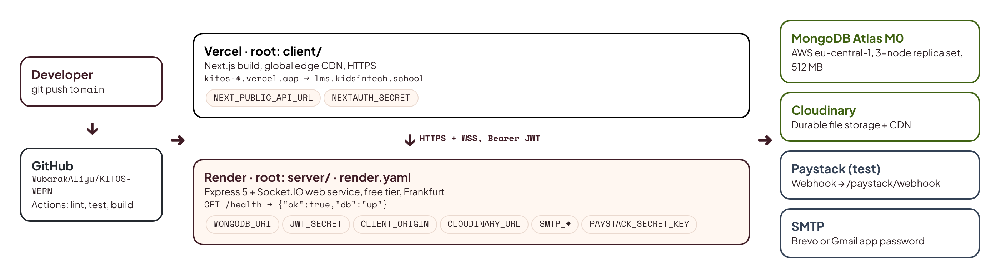

## 3.8 Data Model

The data model was derived by reconciling the entities in the three existing codebases and adding those required for hybrid delivery (tracks, cohorts, attendance, consent). Figure 3.6 shows the main collections and their relationships. Content that is always read together is embedded (questions inside a quiz; resources inside a lesson); data that grows without limit or is shared across documents is referenced (enrolments, submissions, attendance, messages).

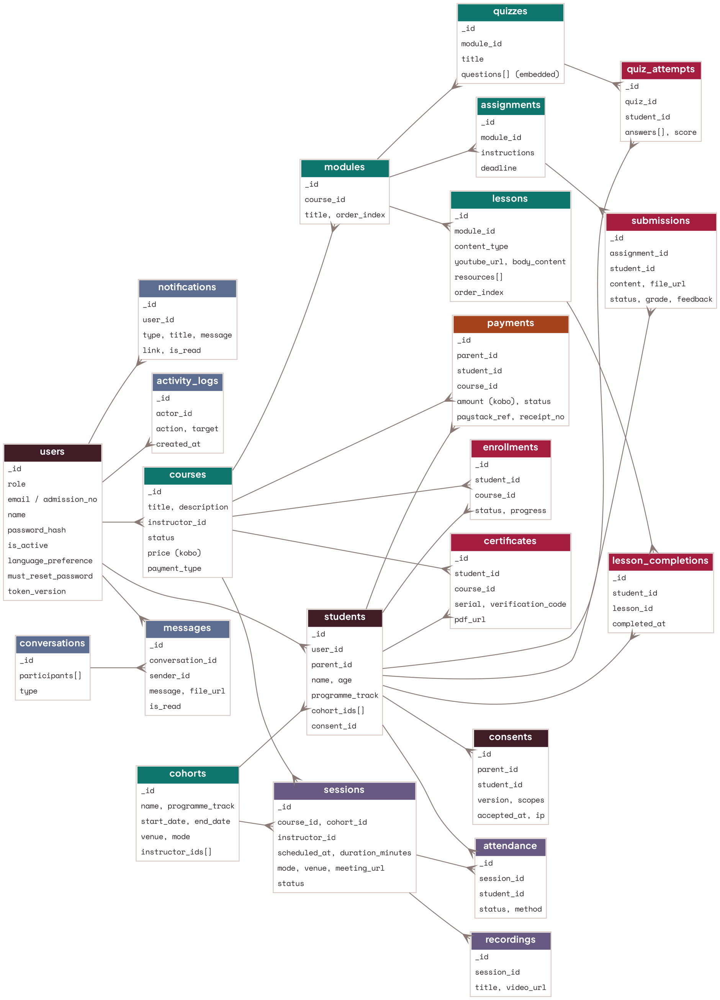

| Collection | Purpose and key fields (snake_case, as in the frontend contract) |
|---|---|
| users | One document per account: `role`, `email`, `admission_no` (students), `name`, `password_hash`, `is_active`, `language_preference`, `must_reset_password`, `token_version`. |
| students | Student profile: `user_id`, `parent_id`, `name`, `age`, `programme_track`, `cohort_ids[]`, `consent_id`. |
| consents | Parental consent record: `parent_id`, `student_id`, `version`, `accepted_at`, `ip`, `scopes` (learning, media, communication). |
| cohorts | A run of a bootcamp or track: `name`, `programme_track`, `start_date`, `end_date`, `venue`, `mode`, `instructor_ids[]`. |
| courses | `title`, `description`, `instructor_id`, `status` (draft, published), `price` (kobo), `payment_type` (subscription, one_time), `thumbnail`. |
| modules / lessons | Ordered by `order_index`; lessons store `content_type`, `youtube_url`, `body_content` and `resources[]`. |
| quizzes / quiz_attempts | Quizzes embed `questions[]` (`question_text`, `question_type`, `options[]`, `correct_answer`); attempts store answers and score. |
| assignments / submissions | `instructions`, `deadline`; submissions store `content`, `file_url`, `status`, `grade`, `feedback`. |
| enrollments / lesson_completions | Student–course membership with `status` and `progress`; per-lesson completion. |
| sessions / attendance / recordings | `scheduled_at`, `duration_minutes`, `mode` (physical, online, hybrid), `venue`, `meeting_url`, `status`; attendance per student with `method` (roster, qr, auto); recordings with `video_url`. |
| certificates | `serial`, `student_id`, `course_id`, `issued_at`, `verification_code`, `pdf_url`. |
| payments / subscriptions | `parent_id`, `student_id`, `course_id`, `amount` (kobo), `type`, `status`, `paystack_ref`, `receipt_no`. |
| conversations / messages | Participants with roles and `type`; messages with `sender_id`, `receiver_id`, `message`, `file_url`, `is_read`. |
| notifications / announcements | Per-user notifications (`type`, `title`, `message`, `link`, `is_read`); broadcasts targeted by role or course. |
| activity_logs / settings / counters | Append-only audit trail; platform settings; atomic counters for admission and receipt numbers. |

Money is stored as integer kobo to avoid floating-point errors. All timestamps are stored in UTC and displayed in the Africa/Lagos time zone.

## 3.9 API Design

The API serves the paths the frontend already calls, relative to `NEXT_PUBLIC_API_URL`. Every route declares the permission it needs and a Zod schema for its input; errors follow one shape (`{ error, reason?, fields? }`), which matches what the frontend's Axios interceptor already reads. Table 3.2 lists representative endpoints; the full reference is generated in `docs/API.md` during implementation.

| Method and path | Purpose | Permission |
|---|---|---|
| POST /login | Sign in with email or admission number; returns `{ user, access }` | Public |
| POST /forgot-password, /reset-password | Email reset link; set new password | Public |
| POST /students | Parent adds a child and records consent | parent |
| GET /parents/me/children | Parent's children with progress | parent |
| GET /courses, /courses/:id/modules | Course catalogue and structure | Signed in |
| POST /modules, /lessons, /quizzes, /assignments | Content authoring | course.edit |
| POST /lessons/:id/complete | Mark a lesson complete; recalculate progress | student (enrolled) |
| POST /quiz/submit | Submit a quiz attempt; auto-grade | student (enrolled) |
| PUT /assignments/:id/feedback | Grade and give feedback | instructor (assigned) |
| GET, POST, PATCH /sessions | List, schedule, reschedule or cancel sessions | session.manage to write |
| POST /sessions/:id/attendance | Record attendance (roster or QR token) | instructor, or student with QR |
| POST /paystack/initiate, /paystack/verify | Start and verify a payment | parent |
| POST /paystack/webhook | Verify Paystack signature; confirm payment | Paystack (HMAC) |
| GET /certificates/verify/:code | Public certificate verification | Public |
| GET /admin/analytics, /admin/activity-log | KPIs, charts and audit trail | admin |

**Table 3.2: Representative API endpoints**

## 3.10 Security and Child-Safety Design

Security is designed into every layer (Table 3.3). The authentication flow is shown in Figure 3.7.

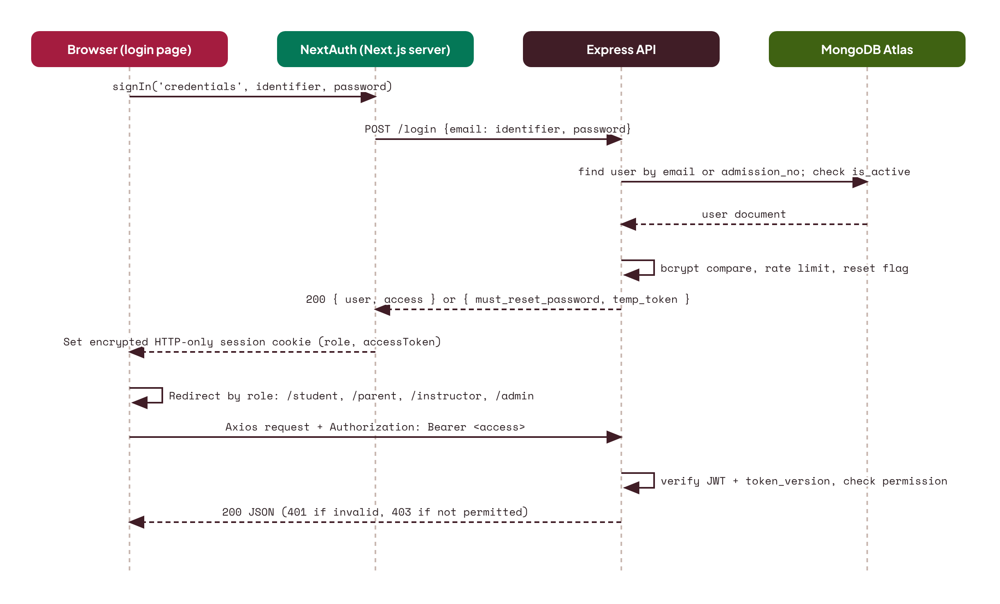

| Risk (OWASP 2021) | Control in KITOS 2.0 |
|---|---|
| A01 Broken access control | One permission matrix enforced by `requirePermission()` middleware on every route; ownership checks in services (a parent may only read their own children; an instructor only their assigned courses). |
| A02 Cryptographic failures | HTTPS everywhere; bcrypt (cost 12) for passwords; the API token is kept inside NextAuth's encrypted, HTTP-only, SameSite=Lax session cookie; reset tokens stored only as SHA-256 hashes. |
| A03 Injection | Zod validation on every input; MongoDB operator sanitisation; Mongoose casting; rich text sanitised with an allow-list. |
| A04 Insecure design | Threat modelling for child accounts; payments confirmed only by server-side webhook verification, never by the browser. |
| A05 Security misconfiguration | Helmet security headers; strict CORS; environment validated at boot; no stack traces in production responses. |
| A07 Identification and authentication failures | Rate limiting and progressive lockout on login; token expiry aligned with the 24-hour session; a per-user token version that revokes all tokens on password change or deactivation; forced password reset for provisioned accounts. |
| A09 Logging and monitoring failures | Structured logs (pino); append-only audit log for admin actions and security events; health checks. |

**Table 3.3: OWASP Top 10 mitigations**

Child-safety controls translate the NDPA and KIT's own policies into rules the software enforces:

- A child account is created only by a parent (or by an admin on a parent's behalf) and stays **pending** until the parent accepts the current consent version. The consent record stores the version, scopes, time and IP address.
- Children sign in with an admission number; **no child email address is required**. Profiles are private and show only first name and avatar to instructors.
- **Messaging is restricted by design**: students can message only their instructors; there is no student-to-student private chat; parents can read their child's conversations; admins can monitor all conversations; messages can be reported and are rate-limited.
- Instructor feedback uses **encouraging templates**, and a wording check flags discouraging phrases before feedback is sent, supporting KIT's positive-language policy.
- No third-party analytics or advertising scripts load in the student area. A child-friendly privacy notice is shown on sign-up and in settings.
- Data minimisation and retention: date of birth is used to confirm the 8–18 age band; inactive accounts can be exported or deleted on a parent's request.

## 3.11 Hybrid Session Design

Hybrid delivery is the defining feature of KITOS. Figure 3.8 shows the lifecycle of a session. An instructor schedules a session as physical (venue), online (meeting link) or hybrid (both). Students and parents receive reminders 24 hours and 15 minutes before it starts. When the session goes live, a banner appears on student dashboards. Physical attendees check in by scanning a short-lived QR code displayed by the instructor, which posts a signed, time-limited token; online attendees are marked present when they join through the platform's link; the instructor can correct the roster afterwards. After the session, the instructor attaches the recording and any resources, and absent students are prompted to catch up.

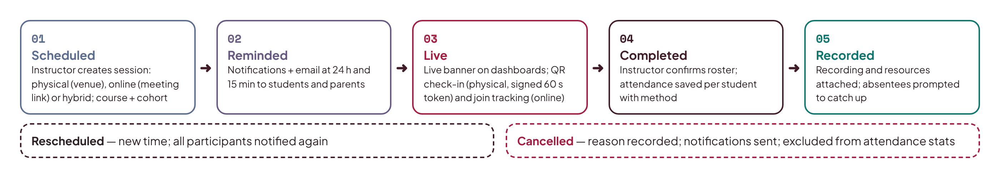

## 3.12 User Interface: Retention and Brand Integration

A full redesign was considered and rejected. The existing interface is complete across four roles, consistent, responsive, bilingual and themeable, and rebuilding it would consume time better spent on the backend that the system actually lacked. Design Science favours building on a working artefact where it meets requirements, so the interface is retained and three targeted changes complete its identity (Figure 3.9):

- **Kids In Tech logo.** The generic lightning-bolt icon in the sidebar, the sign-in screen, the favicon and the certificate template is replaced by the official KIT logotype (with a compact mark for the collapsed sidebar), so the product is recognisably Kids In Tech.
- **"Powered by StarNova Labs".** A small attribution with the StarNova Labs logo sits at the bottom of the sidebar on every dashboard and at the foot of the sign-in page, linking to starnovalabs.com. A light-mode and a dark-mode version of the logo follow the theme toggle.
- **Real states instead of mock states.** Loading skeletons, empty states and error messages, which previously never appeared because mock data always returned instantly, are checked against real network conditions.

The existing tokens are kept unchanged: Plus Jakarta Sans for text, Space Mono for buttons and labels, JetBrains Mono for code, emerald `#10B981` (hover `#059669`) as the accent, navy `#0B1220` for dark panels, and the light and dark surface palettes. Accessibility is verified with axe and Lighthouse against WCAG 2.2 AA, and any contrast failures found are fixed by adjusting the shade of the existing colours rather than introducing new ones.

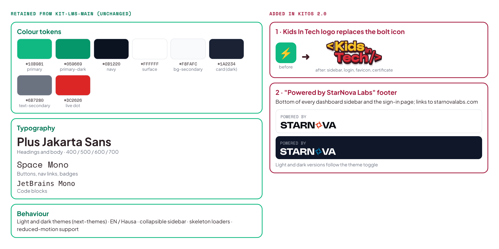

## 3.13 Summary

This chapter applied the Design Science Research Methodology to derive the requirements of KITOS 2.0 and presented its design: a layered MERN architecture deployed on Vercel, Render and MongoDB Atlas; a document data model that makes hybrid delivery first-class; a security design mapped to the OWASP Top 10 and the NDPA; and the retention of the existing interface with the KIT logo and StarNova Labs attribution added.

# CHAPTER FOUR: IMPLEMENTATION, TESTING AND DEPLOYMENT

## 4.1 Introduction

This chapter describes how KITOS 2.0 is implemented, tested and deployed. Implementation proceeds in three batches, each delivering a tested, deployable increment. The detailed build instructions for each batch are given in the companion Product Requirements Document and batch prompts; this chapter explains the structure, key implementation decisions, testing strategy, deployment procedure and evaluation.

## 4.2 Development Environment

| Tool | Version or detail |
|---|---|
| Runtime | Node.js 22 LTS, npm |
| Language | JavaScript (ES modules) with JSDoc types, across client and server |
| Frontend (retained) | Next.js 16, React 19, Tailwind CSS v4, NextAuth, Zustand, Axios, Socket.IO client |
| Backend (new) | Express 5, Mongoose 8, Socket.IO 4, Zod, bcrypt, jsonwebtoken, pino, helmet |
| Local database | mongodb-memory-server replica set (no installation required) |
| Testing | Vitest, Supertest, Playwright, axe-core, Lighthouse |
| Tooling | ESLint 9, GitHub Actions, VS Code, Claude Code for batch execution |

## 4.3 Project Structure

The system is rebuilt in a new repository, `KITOS-MERN`, so the original `kit-lms-main` stays untouched as a reference. The frontend is copied across unchanged in design and becomes the `client` package; the new API is the `server` package.

```
KITOS-MERN/
├── client/                   frontend copied from kit-lms-main (design retained)
│   ├── src/app/              (auth) and (dashboard) route groups for four roles
│   ├── src/_components/      existing UI; brand/ added for KIT logo and StarNova footer
│   ├── src/_lib/api/         Axios services, now pointed at the real API
│   ├── src/_types/schema.js  the API contract the server implements
│   └── public/brand/         KIT and StarNova Labs logo files
├── server/                   new Express API
│   └── src/
│       ├── config/           env (zod-validated), db, permissions matrix
│       ├── models/           Mongoose schemas and indexes
│       ├── routes/           one router per resource, matching the frontend paths
│       ├── controllers/      HTTP to service translation
│       ├── services/         business rules (auth, enrolment, sessions, payments, ...)
│       ├── middleware/       authenticate, requirePermission, validate, rateLimit, errors
│       ├── realtime/         Socket.IO handlers (join, message, typing, notifications)
│       ├── jobs/             reminders and catch-up on boot
│       └── seed/             realistic demo data matching the old mock fixtures
├── docs/                     PRD, batch prompts, API.md, DEPLOYMENT.md, PROGRESS.md
├── render.yaml               Render blueprint for the API (root: server)
└── .github/workflows/ci.yml
```

The legacy PHP API and SQL schema are not copied; they remain in `kit-lms-main/api/` for reference.

## 4.4 Implementation Batches

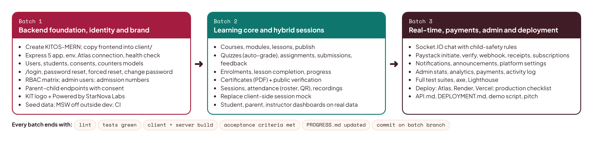

### 4.4.1 Batch 1: Backend Foundation, Identity and Brand

Batch 1 creates the `KITOS-MERN` repository, copies the frontend into `client/` and adds the `server/` package: the Express application factory with security middleware and a health check, zod-validated environment, the MongoDB connection, the in-memory database for local work, and the user, student, parent-link, consent and counter models. It implements the authentication endpoints the frontend already calls (`/login`, `/forgot-password`, `/reset-password`, `/user/change-password`, forced first-login reset), the permission matrix, admin user management with automatic admission numbers, and the parent–child endpoints with consent. On the client it adds the KIT logo and the "Powered by StarNova Labs" footer, points the Axios client at the real API, and turns MSW off outside development. A seed script recreates the demo accounts and fixtures that the mock data used to provide.

### 4.4.2 Batch 2: Learning Core and Hybrid Sessions

Batch 2 implements courses, modules, lessons, quizzes and assignments with the routes the instructor and admin editors already call; enrolment, lesson completion and progress recalculation; submissions and feedback; certificates with public verification; and live sessions, attendance and recordings, replacing the session mock that lived inside the client. The student, parent and instructor dashboards then run on real data end to end.

### 4.4.3 Batch 3: Real-Time, Payments, Admin and Deployment

Batch 3 adds the Socket.IO server for the existing chat screens (with the child-safety rules), Paystack payments with server-side verification, webhook and receipts, subscriptions, notifications and announcements, admin analytics, payments and activity log, and platform settings. It completes the test suites, removes MSW from production, configures Vercel and Render, deploys, runs the production test checklist, and produces the API reference, deployment guide, demo script and presentation material.

## 4.5 Key Implementation Details

### 4.5.1 Layered request handling

Every route follows the same pattern, which keeps business rules testable and out of HTTP code. The path matches the one the frontend already calls:

```js
// server/src/routes/lesson.routes.js
router.post(
  "/lessons/:id/complete",
  authenticate,
  requirePermission("lesson.complete"),
  validate({ params: idParam }),
  lessonController.complete,
);

// server/src/services/progress.service.js
export async function completeLesson(studentId, lessonId) {
  const lesson = await Lesson.findById(lessonId).orFail();
  await assertEnrolled(studentId, lesson.course_id);         // ownership rule
  await LessonCompletion.updateOne(
    { student_id: studentId, lesson_id: lessonId },
    { $setOnInsert: { completed_at: new Date() } },
    { upsert: true },
  );
  return recalculateEnrollment(studentId, lesson.course_id); // may issue a certificate
}
```

### 4.5.2 Permission matrix

Permissions are declared once and checked on the server for every request. The interface's existing role routing decides only what to display; hiding a menu item is never treated as security.

```js
export const PERMISSIONS = {
  "course.edit":     ["admin", "instructor"], // instructor limited to assigned courses in the service
  "session.manage":  ["admin", "instructor"],
  "payment.view":    ["admin", "parent"],     // parent limited to own payments in the service
  "analytics.view":  ["admin"],
  "chat.monitor":    ["admin"],
  "lesson.complete": ["student"],
};
```

### 4.5.3 Sign-in through NextAuth

The frontend's NextAuth `authorize()` callback already posts the identifier and password to `/login` and expects `{ user, access }`, or `{ must_reset_password, temp_token, user }` for a provisioned account. The API returns exactly that. The identifier is treated as an admission number when it matches `KIT/NN/NNN` and as an email otherwise. The signed token carries the user's id, role and token version, and NextAuth stores it in its encrypted session cookie; the existing Axios interceptor attaches it as a Bearer header.

### 4.5.4 Payment confirmation

A payment is never trusted from the browser. The parent's payment modal calls `/paystack/initiate`, which creates a pending payment and a Paystack transaction. The enrolment is activated only when the server verifies the transaction, through `/paystack/verify` after the popup closes or through Paystack's webhook (HMAC-SHA512 signature checked against the secret key). Either path runs one idempotent MongoDB transaction that marks the payment successful, issues an `RCP-` receipt number and activates the enrolment, so a repeated call has no further effect.

### 4.5.5 Real-time chat with safety rules

The Socket.IO server authenticates connections with the same token as the REST API and implements the events the chat hook already uses: `join`, `message` and `typing`. A user can join only the conversations the service allows; the service refuses to create student-to-student conversations; parents can read their child's conversations; and every message is saved before it is broadcast, so offline users receive it when they reconnect and the "offline mode" banner disappears once the server is reachable.

### 4.5.6 Free-tier resilience

Because Render's free tier sleeps after about fifteen minutes of inactivity, scheduled jobs (session reminders and overdue-assignment notices) run on an interval **and once at boot**, catching up on anything missed. The frontend's existing retry-on-network-error interceptor is extended with a longer timeout on the first request so a cold start does not show an error. Uploaded files go to Cloudinary because the server disk is wiped on every deploy.

## 4.6 Testing Strategy

Testing follows the test pyramid, with many fast unit tests, a solid layer of integration tests, and a focused set of end-to-end tests.

| Level | Tools | What is tested |
|---|---|---|
| Unit | Vitest | Services (progress recalculation, admission numbering, permission checks, money helpers, feedback wording check) and validation schemas |
| Integration | Vitest, Supertest, mongodb-memory-server | Every API route against an in-memory replica set: success, validation errors, permission denials, ownership rules, transactions |
| End-to-end | Playwright (desktop and Pixel 7) | Critical journeys per role: parent registers child and consents; student signs in, completes lesson and quiz; instructor schedules session and takes attendance; parent pays; admin views analytics |
| Accessibility | axe-core in Playwright, Lighthouse | No serious or critical violations on key pages; accessibility score of 95 or more |
| Performance | Lighthouse CI, API timing | Performance score of 90 or more; API p95 under 500 ms after warm-up |
| Security | Automated tests and manual checklist | Access-control matrix tests; rate limiting; cookie flags; webhook signature rejection; dependency audit |

Continuous integration runs linting, unit and integration tests and production builds of both the frontend and the API on every push and pull request (Figure 4.2). A failing check blocks deployment.

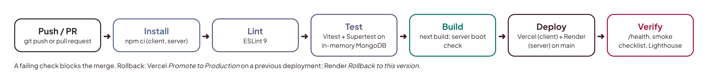

## 4.7 Deployment

Deployment follows the same proven procedure used in the author's previous MERN lab project:

1. **MongoDB Atlas.** Create a free M0 cluster (AWS, Frankfurt `eu-central-1`); create a database user with an autogenerated password; allow network access from anywhere (Render's free tier has no fixed outbound IP); copy the connection string as `MONGODB_URI`.
2. **Cloudinary.** Create a free account and copy `CLOUDINARY_URL`.
3. **SMTP.** Create a Brevo SMTP key, or a Gmail app password for the KIT address, and verify the sender.
4. **Paystack.** Use test-mode secret and public keys; register the webhook URL `https://<api-domain>/paystack/webhook`.
5. **Render (API).** Create a Blueprint from the GitHub repository; Render reads `render.yaml` (root directory `server`), generates the JWT secret and asks for the remaining secrets. Confirm that `/health` returns `{"ok":true,"db":"up"}`.
6. **Vercel (frontend).** Import the repository with root directory `client`; set `NEXT_PUBLIC_API_URL` and `NEXT_PUBLIC_SOCKET_URL` to the Render URL, `NEXTAUTH_URL` and `NEXT_PUBLIC_LMS_URL` to the Vercel URL, and a fresh `NEXTAUTH_SECRET`; deploy.
7. **Connect them.** Set `CLIENT_ORIGIN` on Render to the Vercel URL and redeploy. Optionally attach the custom domain `lms.kidsintech.school`.
8. **Seed demo data.** Run the guarded production seed once from a local machine with `ALLOW_DEMO_SEED=true` and demo passwords supplied on the command line only.

Redeployment happens automatically on push to `main`. Rollback is one action on either host (Vercel: promote a previous deployment; Render: roll back to a previous deploy). The database is never rolled back; migrations are written to be idempotent and fixed forward.

| Variable | Host | Notes |
|---|---|---|
| MONGODB_URI | Render (secret) | Atlas connection string |
| JWT_SECRET | Render (generated) | 32-byte random value |
| CLIENT_ORIGIN | Render | Vercel production URL; used for CORS and Socket.IO |
| CLOUDINARY_URL | Render (secret) | Durable file storage |
| SMTP_HOST, SMTP_PORT, SMTP_USER, SMTP_PASSWORD, MAIL_FROM | Render (secret) | Transactional email |
| PAYSTACK_SECRET_KEY | Render (secret) | Test mode; also used to verify webhook signatures |
| NEXT_PUBLIC_API_URL, NEXT_PUBLIC_SOCKET_URL | Vercel | Render URL |
| NEXTAUTH_URL, NEXT_PUBLIC_LMS_URL | Vercel | Vercel production URL |
| NEXTAUTH_SECRET | Vercel (secret) | Session encryption key |
| NEXT_PUBLIC_PAYSTACK_PUBLIC_KEY | Vercel | Public key for the payment popup |

**Table 4.1: Production environment variables**

## 4.8 Evaluation

The system is evaluated against its objectives and requirements using the measures in Table 4.2. Results are recorded from the live deployment in the production test report (`docs/DEPLOYMENT.md`) once Batch 3 is complete, and summarised in the final presentation.

| Measure | Target | Method | Result |
|---|---|---|---|
| Functional requirements met | FR1–FR16 | Production test checklist (one row per requirement) | Recorded after Batch 3 |
| Automated tests | All green; service coverage of 70% or more | CI run on `main` | Recorded after Batch 3 |
| Lighthouse performance (student dashboard, lesson page) | 90 or more | Lighthouse on live URL, mobile profile | Recorded after Batch 3 |
| Lighthouse accessibility | 95 or more | Lighthouse and axe | Recorded after Batch 3 |
| API latency | p95 under 500 ms after warm-up | Timed requests to `/api/health` and dashboard endpoints | Recorded after Batch 3 |
| Access control | Zero unauthorised reads or writes | Permission-matrix integration tests | Recorded after Batch 3 |
| Usability | SUS score of 70 or more | System Usability Scale questionnaire with instructors and parents | Recorded after pilot |

**Table 4.2: Evaluation plan and results**

## 4.9 Summary

KITOS 2.0 keeps its existing Next.js interface and gains a real Express and MongoDB backend, built in three tested increments and deployed to Vercel, Render and MongoDB Atlas with continuous integration, and evaluated against measurable targets for functionality, performance, accessibility, security and usability.

# CHAPTER FIVE: SUMMARY, CONCLUSION AND RECOMMENDATIONS

## 5.1 Summary

This study set out to design, develop and deploy a cloud-based hybrid learning management system for Kids In Tech, a children's coding and STEM programme in Northern Nigeria. Chapter One established the problem: learning stops when bootcamps end, online sessions are run through scattered tools, parents lack visibility, children's data is handled informally, and the existing KITOS system runs on mock data with three incompatible backends and an off-brand design. Chapter Two reviewed the literature on blended learning, children's computing education, interface design for children, e-learning in Nigeria, LMS platforms, cloud-native architecture, security and child data protection, and identified the gap that no existing platform combines bootcamp-plus-online delivery, cohort and attendance management, a branching curriculum, parental consent and payments, child-safe communication and a bilingual interface at a cost a small organisation can sustain. Chapter Three applied the Design Science Research Methodology to specify requirements and design a layered MERN architecture on managed cloud services, a document data model, and a security and child-safety design, while retaining the existing interface and completing its brand identity. Chapter Four described how the existing interface was retained and connected to a new backend in three batches, the testing strategy, the deployment procedure and the evaluation plan.

## 5.2 Contributions

1. **A unified hybrid learning platform.** KITOS 2.0 makes physical and online sessions, cohorts, attendance and recordings first-class parts of one system, turning one-off bootcamps into a continuous programme.
2. **Privacy and child safety by design.** The study shows how the NDPA 2023 and an organisation's child-safety policy can be translated into enforceable software rules: parent-created accounts with recorded consent, no child email requirement, restricted messaging with parental visibility, encouraging-feedback checks and an audit trail.
3. **A reproducible low-cost cloud architecture.** The deployment demonstrates that a production-grade, secure, tested system can run on free tiers of Vercel, Render and MongoDB Atlas, with documented workarounds for free-tier constraints.
4. **Reuse over rebuild.** Implementing the backend against the contract the existing frontend already defined replaced three incompatible backends with one, without discarding the interface work already done, an approach other teams with mock-driven prototypes can follow.
5. **Clear identity.** The product now carries the Kids In Tech logo and credits StarNova Labs, so parents and partners can see who runs it.

## 5.3 Limitations

The system runs on free tiers, so the API has a cold-start delay after periods of inactivity. Evaluation is based on automated measures and a small pilot rather than a long-term study of learning outcomes. Payments run in test mode. Hausa translations need native-speaker review. Live video relies on external meeting tools.

## 5.4 Recommendations and Future Work

1. **Measure learning outcomes.** Run a cohort-level study comparing continuation, project completion and attendance before and after KITOS 2.0.
2. **Upgrade hosting when usage grows.** Move the API to a paid Render instance (no cold starts) and Atlas M10 for dedicated resources and point-in-time recovery.
3. **Offline-first progressive web app.** Cache lesson text and resources for offline study, which matters given Nigeria's connectivity gaps.
4. **Partner-school portal.** Add teacher accounts and class management for partner schools, as planned on the KIT website.
5. **AI tutor with safeguards.** Introduce a moderated AI helper that explains concepts and hints at solutions without giving answers, with parental controls and no retention of children's conversations.
6. **Gamification.** Add badges, streaks and a project showcase, consistent with constructionist and social learning principles.
7. **Visual alignment with the KIT website.** A later iteration could bring the website's warmer palette into the LMS, and a native speaker should review the Hausa interface.

## 5.5 Conclusion

KITOS 2.0 addresses a real problem for a real organisation: sustaining children's technology learning beyond the classroom in a context of limited connectivity, limited budgets and growing data-protection obligations. By grounding its design in blended-learning and constructionist research, reusing a proven interface, building on a MERN architecture deployed to managed cloud platforms, and enforcing child safety in the software itself, the project delivers a scalable, secure and production-ready platform. It shows that a small African EdTech team can build and operate a professional cloud system that keeps the spark from a bootcamp burning all year round.

# REFERENCES

Bers, M. U. (2018). *Coding as a playground: Programming and computational thinking in the early childhood classroom*. Routledge.

Cattell, R. (2011). Scalable SQL and NoSQL data stores. *ACM SIGMOD Record, 39*(4), 12–27.

Davis, F. D. (1989). Perceived usefulness, perceived ease of use, and user acceptance of information technology. *MIS Quarterly, 13*(3), 319–340.

DeLone, W. H., & McLean, E. R. (2003). The DeLone and McLean model of information systems success: A ten-year update. *Journal of Management Information Systems, 19*(4), 9–30.

Dhawan, S. (2020). Online learning: A panacea in the time of COVID-19 crisis. *Journal of Educational Technology Systems, 49*(1), 5–22.

Dougiamas, M., & Taylor, P. (2003). Moodle: Using learning communities to create an open source course management system. In *Proceedings of EdMedia 2003* (pp. 171–178). AACE.

Eze, S. C., Chinedu-Eze, V. C., & Bello, A. O. (2018). The utilisation of e-learning facilities in the educational delivery system of Nigeria: A study of M-University. *International Journal of Educational Technology in Higher Education, 15*, 34.

Federal Republic of Nigeria. (2023). *Nigeria Data Protection Act, 2023*. Official Gazette.

Fielding, R. T. (2000). *Architectural styles and the design of network-based software architectures* (Doctoral dissertation). University of California, Irvine.

Garrison, D. R., & Kanuka, H. (2004). Blended learning: Uncovering its transformative potential in higher education. *The Internet and Higher Education, 7*(2), 95–105.

Graham, C. R. (2006). Blended learning systems: Definition, current trends, and future directions. In C. J. Bonk & C. R. Graham (Eds.), *The handbook of blended learning* (pp. 3–21). Pfeiffer.

Hevner, A. R., March, S. T., Park, J., & Ram, S. (2004). Design science in information systems research. *MIS Quarterly, 28*(1), 75–105.

Hourcade, J. P. (2008). Interaction design and children. *Foundations and Trends in Human–Computer Interaction, 1*(4), 277–392.

Jones, M., Bradley, J., & Sakimura, N. (2015). *JSON Web Token (JWT)* (RFC 7519). Internet Engineering Task Force.

Kafai, Y. B., & Burke, Q. (2014). *Connected code: Why children need to learn programming*. MIT Press.

Kids In Tech. (2026). *Kids In Tech: About, programmes and KITOS*. StarNova Labs. https://kidsintech.school

Livingstone, S., Stoilova, M., & Nandagiri, R. (2019). *Children's data and privacy online: Growing up in a digital age*. London School of Economics and Political Science.

Means, B., Toyama, Y., Murphy, R., Bakia, M., & Jones, K. (2010). *Evaluation of evidence-based practices in online learning: A meta-analysis and review of online learning studies*. U.S. Department of Education.

Means, B., Toyama, Y., Murphy, R., & Baki, M. (2013). The effectiveness of online and blended learning: A meta-analysis of the empirical literature. *Teachers College Record, 115*(3), 1–47.

Mell, P., & Grance, T. (2011). *The NIST definition of cloud computing* (Special Publication 800-145). National Institute of Standards and Technology.

OWASP Foundation. (2021). *OWASP Top 10: 2021*. https://owasp.org/Top10/

Papert, S. (1980). *Mindstorms: Children, computers, and powerful ideas*. Basic Books.

Peffers, K., Tuunanen, T., Rothenberger, M. A., & Chatterjee, S. (2007). A design science research methodology for information systems research. *Journal of Management Information Systems, 24*(3), 45–77.

Resnick, M., Maloney, J., Monroy-Hernández, A., Rusk, N., Eastmond, E., Brennan, K., Millner, A., Rosenbaum, E., Silver, J., Silverman, B., & Kafai, Y. (2009). Scratch: Programming for all. *Communications of the ACM, 52*(11), 60–67.

Sherwin, K., & Nielsen, J. (2019). *Children's UX: Usability issues in designing for young people*. Nielsen Norman Group. https://www.nngroup.com/articles/childrens-websites-usability-issues/

TechCabal. (2025, December 24). Nigeria's internet penetration crosses 50%, still short of national target. https://techcabal.com/2025/12/24/nigeria-50-percent-internet-penetration-broadband-target/

Udo Udoma & Belo-Osagie. (2024). *Personal data of a minor: What you must know*. https://uubo.org/document/personal-data-of-a-minor-what-you-must-know

UNESCO. (2023). *Global education monitoring report 2023: Technology in education: A tool on whose terms?* UNESCO.

Voice of Nigeria. (2024). *NITDA targets 95% digital literacy in Nigeria by 2030*. https://von.gov.ng/?p=344912

W3C. (2023). *Web Content Accessibility Guidelines (WCAG) 2.2*. World Wide Web Consortium. https://www.w3.org/TR/WCAG22/

Wiggins, A. (2011). *The twelve-factor app*. https://12factor.net

Wing, J. M. (2006). Computational thinking. *Communications of the ACM, 49*(3), 33–35.
